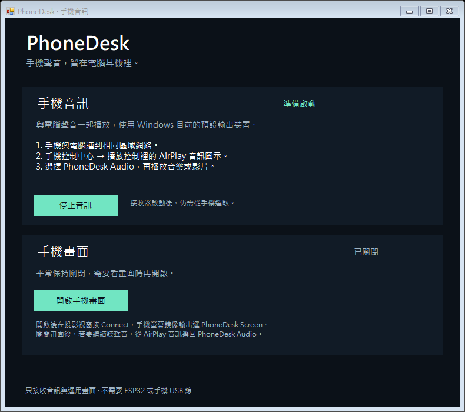

# PhoneDesk Audio

Windows 上的 iPhone 音訊接收工具；平常只聽手機聲音，需要時才開啟畫面投影。



## 功能

- 開啟程式後自動啟動音訊接收器，使用 Windows 預設播放裝置的共享模式。
- 手機聲音與電腦聲音可以一起由電腦耳機播放。
- 手機畫面預設關閉；按按鈕才開啟獨立 iMirror 投影視窗。
- 每次啟動都從關閉畫面的狀態開始。
- 不含手機操作、鍵鼠、文字輸入、WDA 或 ESP32 控制功能。
- 原生 Windows Forms 介面，不需要 Node.js 或 Electron。

## 使用

1. 手機與電腦連到相同區域網路，開啟 `PhoneDesk.exe`。
2. 在手機控制中心的播放控制中點 AirPlay 音訊圖示，選 **PhoneDesk Audio**。
3. 播放音樂或影片；聲音會由 Windows 預設耳機／喇叭輸出。
4. 要看畫面時，按 **開啟手機畫面**，在 iMirror 按 Connect，再從手機「螢幕鏡像輸出」選 **PhoneDesk Screen**。
5. 關閉畫面後，若要繼續純音訊，從手機 AirPlay 選回 **PhoneDesk Audio**。

接收器「已啟動」只代表程序正在執行，並不代表已收到手機串流。切換音訊與畫面接收器需要在手機重新選擇。關閉程式會停止本程式啟動的接收器。iMirror 視窗需維持開啟才能投影。

## 建置

Windows x64、Windows PowerShell 5.1 或 PowerShell 7，以及 .NET Framework 4.x 編譯器（通常由 Windows 提供）。不需要額外 NuGet 套件。

```powershell
.\scripts\Build.ps1
```

腳本下載固定版本的 iMirror 與兩個 GStreamer 音訊元件，逐一檢查 SHA-256，再編譯原生介面與音訊參數轉接器。成品在 `dist/PhoneDesk/`；保留 `PhoneDesk.exe` 與旁邊的 `resources` 資料夾。

```powershell
.\scripts\Test.ps1
# 另外測試實際接收器啟動與選用投影（會短暫開啟 iMirror）
.\scripts\Test.ps1 -Integration
```

整合測試前請先關閉其他 iMirror／PhoneDesk，避免接收器互相衝突。

## 驗證狀態與限制

本機已驗證：純音訊接收器啟動與停止、預設不開畫面、手動開關投影時音訊接收器仍執行、原生介面編譯。端到端手機音訊、延遲、受保護內容與不同 iOS／Windows 版本的相容性仍需實機驗證。電話、鬧鐘與部分 App 不一定使用 AirPlay 音訊路由。

本儲存庫不含第三方二進位檔、個人設定、憑證、手機資料或歷史控制版本。第三方來源、授權與下載雜湊見 [THIRD-PARTY.md](THIRD-PARTY.md) 與 [runtime.lock.json](runtime.lock.json)。目前未另行指定本專案原始碼授權；公開可見不等同於授權任意重用。
